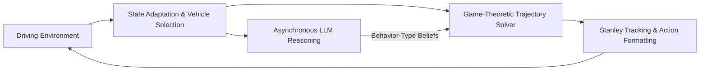

<div align="center">

# LLMGame

### LLM-Enhanced Game-Theoretic Decision-Making for Autonomous Driving

Combining asynchronous language-model reasoning with game-theoretic trajectory decisions in interactive driving scenarios.

[Quick Start](#quick-start) · [Overview](#overview) · [Scenarios](#driving-scenarios) · [Experiments](#experiments) · [Results & Videos](#results--videos)

</div>

## Overview

LLMGame studies interactive autonomous-driving decisions with heterogeneous surrounding vehicles. A language model estimates their behavioral types, and a game-theoretic solver incorporates these beliefs into trajectory decisions. A Stanley controller computes steering commands, while the simulator executes the planned trajectory points.



The repository includes:

- The current decision model, behavioral prompts, driving-style parameters, and trajectory execution loop.
- Four driving scenarios: dense-traffic cut-in, highway cruising, adversarial merging, and standard merging.
- Ablation and vehicle-type evaluation scripts with their experiment configurations and archived results.
- Eight original simulation videos extracted from the presentation, two complete real-vehicle videos, and archived experimental data.

Comparison-method implementations and pretrained weights for DiLu, DQN, PPO, and THCAD are not included. This project uses an LLM API and does not require a local neural-network checkpoint or an initial training stage.

## Quick Start

### 1. Download the repository

Install [Git LFS](https://git-lfs.com/) to retrieve the complete videos:

```bash
git lfs install
git clone https://github.com/RedwhiskeredBulbul/llmgame.git
cd llmgame
git lfs pull
```

For code-only use, clone with `GIT_LFS_SKIP_SMUDGE=1` and download the media later with `git lfs pull`. All commands below should be run from the repository root.

### 2. Set up the Python environment

Python 3.11 is recommended for the original dependency constraints.

```bash
python -m venv .venv
# Windows PowerShell
.venv\Scripts\Activate.ps1
# Linux / macOS
# source .venv/bin/activate

python -m pip install -r requirements.txt
```

Development dependencies and optional video recording:

```bash
python -m pip install -r requirements-dev.txt
python -m pip install -r requirements-video.txt
```

### 3. Configure LLM inference

The default backend is an OpenAI-compatible DashScope endpoint. Set your own API key in the terminal:

```powershell
# Windows PowerShell
$env:DASHSCOPE_API_KEY = "your-api-key"
$env:LLM_VEHICLE_MODEL = "qwen-turbo"
$env:LLM_VEHICLE_BASE_URL = "https://dashscope.aliyuncs.com/compatible-mode/v1"
```

```bash
# Linux / macOS
export DASHSCOPE_API_KEY="your-api-key"
export LLM_VEHICLE_MODEL="qwen-turbo"
export LLM_VEHICLE_BASE_URL="https://dashscope.aliyuncs.com/compatible-mode/v1"
```

`.env.example` documents these variables; the program does not automatically load `.env` files. Keep credentials out of tracked files.

### 4. Run a driving scenario

```bash
# Run the current model
python main.py --env HighwayEnv --seed 13 --max-steps 600

# Run without online LLM belief updates
python main.py --env CutinEnv --seed 13 --max-steps 30 --no-llm

# Record a new simulation video (requires optional video dependencies)
python main.py --env AdversarialMergeEnv --seed 13 --max-steps 600 --record-video
```

Outputs are saved to `results/<environment>/seed_<seed>/`:

| File | Contents |
| --- | --- |
| `vehicle_states.csv` | Recorded ego and surrounding-vehicle states |
| `metrics.json` | Average speed, acceleration variability, and minimum TTC |
| `*.mp4` | Recorded simulation, when `--record-video` is enabled |

`--no-llm` preserves the game solver's prior and internal belief-update logic; it is not the uniform-belief experimental variant. The original demonstration switches the ego driving style from conservative to aggressive at step 380. Archived experiment configurations can use different prompts and settings from the default demonstration.

## Driving Scenarios

| Environment ID | Scenario | Implementation |
| --- | --- | --- |
| `CutinEnv` | Cut into a dense traffic stream on a two-lane road | [cutin_env.py](highway_env/envs/cutin_env.py) |
| `HighwayEnv` | Four-lane highway cruising | [highway_env.py](highway_env/envs/highway_env.py) |
| `AdversarialMergeEnv` | Merge while a main-road vehicle blocks the available gap | [adversarial_merge_env.py](highway_env/envs/adversarial_merge_env.py) |
| `MergeEnv` | Standard highway-ramp merging | [merge_env.py](highway_env/envs/merge_env.py) |

```python
import gymnasium as gym
import highway_env

env = gym.make("CutinEnv", render_mode="rgb_array")
observation, info = env.reset(seed=13)
# The trajectory/action format is implemented in simulation/actions.py.
env.close()
```

The four scenarios use the project's `Trajectory_for_mpc_curve` interface. Ego state execution follows planned trajectory points; the demonstration is not a validation of a physical vehicle dynamics controller.

## Repository Structure

```text
llmgame/
├── main.py                    # Simulation command-line entry point
├── model/
│   ├── game/                  # Game solver and driving-style parameters
│   ├── reasoning/             # Asynchronous LLM worker and prompts
│   ├── control/               # Stanley tracking controller
│   ├── perception/            # State adaptation and interaction selection
│   ├── geometry/              # Collision detection
│   └── settings.py            # Parameters used by the current model
├── simulation/                # Episode loop, action conversion, and metrics
├── highway_env/               # Four environments and simulator infrastructure
├── experiments/               # Ablation and vehicle-type experiments
├── configs/                   # Experiment-specific JSON configurations
├── tests/                     # Regression and integration tests
├── docs/                      # Architecture, protocols, and validation notes
├── experiment_results/        # Videos, quantitative tables, and recordings
└── simulation_results/        # Archived experiment data and logs
```

### Main Modules

| Module | Responsibility |
| --- | --- |
| [simulation/runner.py](simulation/runner.py) | Connect observations, belief updates, game decisions, and environment execution |
| [model/reasoning/worker.py](model/reasoning/worker.py) | Infer surrounding-vehicle behavior types from observation histories |
| [model/game/solver.py](model/game/solver.py) | Solve trajectory decisions using beliefs, style parameters, rewards, and constraints |
| [model/game/style_params.py](model/game/style_params.py) | Define driving-style parameters |
| [model/perception/filter.py](model/perception/filter.py) | Select interaction vehicles and determine speed limits |
| [model/perception/env_adapter.py](model/perception/env_adapter.py) | Convert simulator observations and maintain scenario road references |
| [model/control/stanley.py](model/control/stanley.py) | Compute steering commands for the selected path |
| [simulation/actions.py](simulation/actions.py) | Convert solver trajectories into environment actions |

The core `model/` package is independent of experiment scripts. See the [structure guide](docs/structure.md) for the reading order and the scope of code cleanup.

## Experiments

```bash
# General ablation study
python -m experiments.ablation --help

# Configurable ablation experiments
python -m experiments.ablation_v2.run --help

# Vehicle-type data collection and evaluation
python -m experiments.vehicle_types.collect --help
python -m experiments.vehicle_types.evaluate --help
python -m experiments.vehicle_types.online --help
python -m experiments.vehicle_types.prototypes --help
```

`configs/` contains experimental variants, scene settings, seeds, solver budgets, prompt versions, and LLM query settings. These JSON files are read by experiment scripts; `main.py` does not load them. Runtime model parameters are in `model/settings.py` and `model/game/style_params.py`.

Historical synthetic experiment scenes are instantiated within `experiments/ablation_v2/synthetic_env.py` and do not register additional `highway_env` environments. New type-labeled data collection uses `CutinEnv`; it is not equivalent to the removed historical cruise scene.

## Results & Videos

### Quantitative Results

The following values were transcribed from the supplied presentation. They describe the original experiments and have not been recomputed from this cleaned repository. The extracted [source table](experiment_results/presentation_metrics.csv) is included.

| Scenario | Method / Passenger Instruction | Average Speed (m/s) | Acceleration Variability | Min TTC (s) |
| --- | --- | ---: | ---: | ---: |
| Highway | DiLu | 23.30 | 0.4300 | 23.92 |
| Highway | DQN | 24.52 | 6.1700 | 7.45 |
| Highway | PPO | 22.47 | 0.4100 | 31.88 |
| Highway | THCAD | 25.46 | 0.3800 | 8.65 |
| Highway | Ours — “I'm late for work” | 27.76 | 0.1199 | 9.32 |
| Highway | Ours — “I still have a lot of time” | 27.30 | 0.0964 | 10.54 |
| Merging | DiLu | 15.88 | 2.0100 | 7.59 |
| Merging | DQN | 18.69 | 3.7200 | 2.62 |
| Merging | PPO | 16.31 | 1.9600 | 5.21 |
| Merging | THCAD | 14.51 | 0.3200 | 18.93 |
| Merging | Ours — “I'm late for work” | 23.16 | 0.9704 | 10.32 |
| Merging | Ours — “I still have a lot of time” | 22.81 | 0.9291 | 10.55 |

### Simulation Videos

All eight MP4s retain the original embedded files, without trimming or transcoding:

[Video 1](experiment_results/highway_videos/media1.mp4) · [Video 2](experiment_results/highway_videos/media2.mp4) · [Video 3](experiment_results/highway_videos/media3.mp4) · [Video 4](experiment_results/highway_videos/media4.mp4) · [Video 5](experiment_results/highway_videos/media5.mp4) · [Video 6](experiment_results/highway_videos/media6.mp4) · [Video 7](experiment_results/highway_videos/media7.mp4) · [Video 8](experiment_results/highway_videos/media8.mp4)

### Real-Vehicle Videos

- [DJI_0351.MP4 — complete original video](experiment_results/real_vehicle_videos/DJI_0351.MP4)
- [DJI_0354.MP4 — complete original video](experiment_results/real_vehicle_videos/DJI_0354.MP4)

The videos document the supplied real-vehicle experiments. The cleaned runtime does not include the original ROS deployment workspace. Videos are stored through Git LFS; use `git lfs pull` to retrieve their full contents.

### Additional Artifacts

- [Simulation recordings](experiment_results/simulation_recordings/)
- [Raw numerical results and datasets](simulation_results/)
- [Media SHA-256 integrity records](experiment_results/media_integrity.json)

Archived logs retain their original environment names, paths, and source hashes to preserve provenance.

## Validation

```bash
python -m pytest tests -q
```

The cleanup was checked with 36 passing tests. Four offline three-step runs with seed 13 matched the pre-cleanup vehicle-state records within `rtol=1e-9`, `atol=1e-9`. These checks establish short-run consistency, not a rerun of the presentation's full experiments. Online LLM calls, new video recording, and real-vehicle deployment were not revalidated during cleanup. See [validation notes](docs/validation.md).

## Acknowledgements

The simulator builds on [highway-env](https://github.com/Farama-Foundation/HighwayEnv). The README organization follows the quick-start, overview, and module-description style of [Actor-Reasoner](https://github.com/FanGShiYuu/Actor-Reasoner); this repository implements its own model and experiment workflow.
