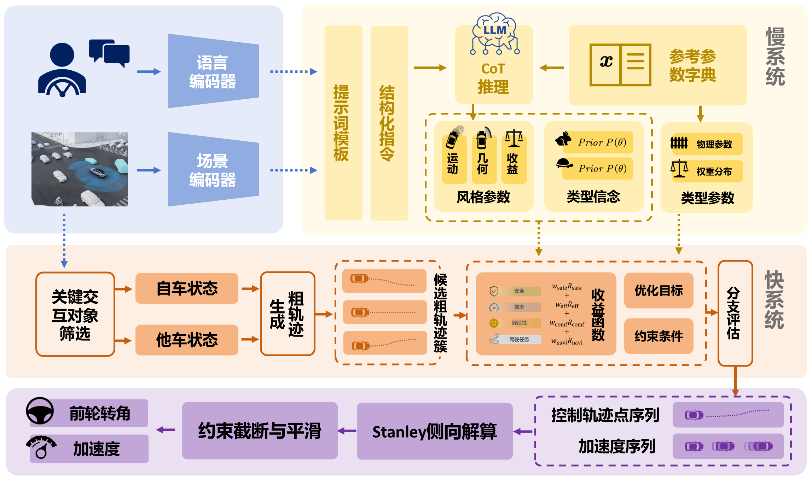

# LLMGame: LLM-Enhanced Game-Theoretic Decision-Making for Autonomous Driving

LLMGame combines language-model reasoning with game-theoretic trajectory decisions for interactive autonomous driving.



## Getting started

### 1. Install the dependencies

Python 3.11 is recommended.

```bash
git clone https://github.com/RedwhiskeredBulbul/llmgame.git
cd llmgame
pip install -r requirements.txt
```

### 2. Configure the LLM

The default backend is DashScope with `qwen-turbo`. Set your own API key before running the model. For Windows PowerShell:

```powershell
$env:DASHSCOPE_API_KEY = "your-api-key"
```

The model and endpoint can be changed with `LLM_VEHICLE_MODEL` and `LLM_VEHICLE_BASE_URL`; see [.env.example](.env.example).

### 3. Run the simulation

```bash
python main.py --env HighwayEnv --seed 13 --max-steps 600
```

Available environments are `HighwayEnv`, `MergeEnv`, `AdversarialMergeEnv`, and `CutinEnv`. To run without online LLM inference:

```bash
python main.py --env CutinEnv --seed 13 --max-steps 600 --no-llm
```

Outputs are saved in `results/`. For video recording, install `requirements-video.txt` and add `--record-video`.

## Overview

### Repo description

Included:

- The LLM reasoning and game-theoretic decision model.
- Highway cruising, ramp merging, adversarial merging, and dense-traffic cut-in environments.
- Experiment configurations, results, and complete simulation and real-vehicle videos.

Not included:

- Implementations or pretrained weights of the comparison algorithms.
- The original ROS deployment workspace.

### Files description

**Main functions**

- `main.py`: Runs the model in a selected driving scenario.
- `simulation/runner.py`: Connects observations, LLM belief updates, game decisions, and simulation execution.

**Decision model**

- `model/reasoning/worker.py`: Infers surrounding-vehicle behavior types from observation histories.
- `model/game/solver.py`: Computes trajectory decisions using behavior beliefs and driving-style parameters.
- `model/control/stanley.py`: Computes steering commands for the selected trajectory.

**Environment and tools**

- `highway_env/`: Defines the four driving environments and simulator infrastructure.
- `model/perception/`: Adapts environment observations and selects interaction vehicles.
- `model/settings.py` and `model/game/style_params.py`: Define model and driving-style parameters.
- `experiments/` and `configs/`: Provide ablation and vehicle-type evaluation scripts and their configurations.

**Experiment materials**

- [Simulation videos](experiment_results/highway_videos/) and [real-vehicle videos](experiment_results/real_vehicle_videos/).
- [Numerical results and datasets](simulation_results/).

Videos are stored with Git LFS. Run `git lfs install` and `git lfs pull` to download the complete files.
